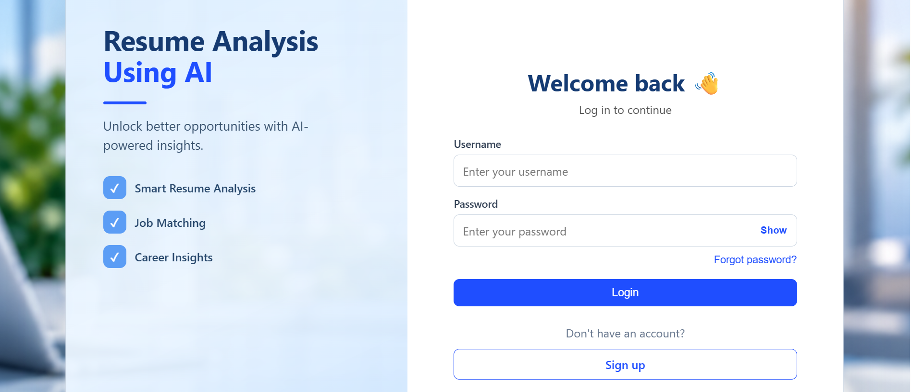
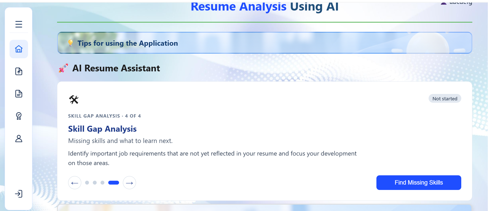

# Resume AI Builder — React + FastAPI

## Screenshots

### Login


### Main dashboard


## 1. Database (automatic)
The backend now creates the database and the 3 tables itself on startup (backend/init_db.py).
You only need PostgreSQL running and correct DB_* values in backend/.env.
Manual option (not required):
```powershell
psql -U postgres -c "CREATE DATABASE resume_ai;"
psql -U postgres -d resume_ai -f backend\Database_connection.sql
psql -U postgres -d resume_ai -c "\dt"      # should list 3 tables
```

## 2. Backend (terminal 1)
```powershell
cd backend
python -m venv .venv
.venv\Scripts\activate
python -m pip install -r requirements.txt
# Run this again after pulling dependency changes to update incompatible installed versions.
# backend\.env is already included - edit it if your DB name or password differs
uvicorn main:app --reload --host 127.0.0.1 --port 8000
```
Check: http://127.0.0.1:8000/api/health  ->  {"status":"ok"}

## 3. Frontend (terminal 2)
```powershell
cd frontend
npm install
npm run dev
```
Open http://localhost:5173  (resume must be a PDF)

## Notes
- AI model is set in backend/analysis.py (`MODEL = "openai/gpt-oss-120b"`).
- Vite proxies /api -> http://127.0.0.1:8000 (frontend/vite.config.js).
- Errors now show their real message in the UI; full traceback is in the uvicorn terminal.

## Login
- The app now opens on a login page (username + password). Below the Login button:
  "Forgot password?" on the left and "New user? Sign up" on the right.
- Accounts live in the `users` table (created automatically). Passwords are stored hashed.
- Every /api route except /api/auth/* and /api/health requires the login token.
- Forgot password: enter your username + the email used at sign up, then choose a new password.
- Tokens are signed with SECRET_KEY / ALGORITHM from backend/.env and last 12 hours.
- After updating, run `pip install -r requirements.txt` again (adds PyJWT).
